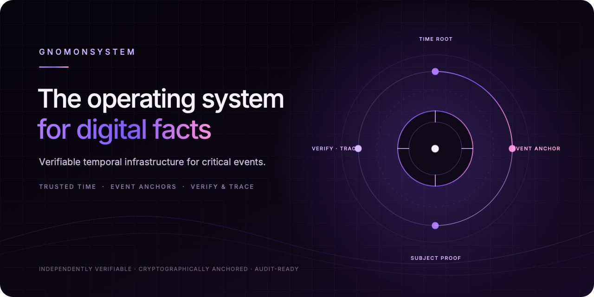
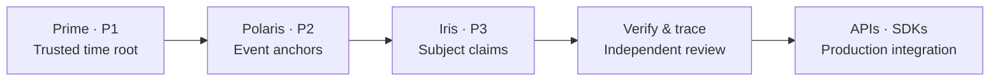

  

  
  
  
  

# GnomonSystem

### The operating system for digital facts

GnomonSystem is verifiable temporal infrastructure for critical digital events. It makes each event independently reviewable: **when it happened, who performed it, and whether it changed**—without requiring trust in a central authority. SM2 signatures and SM3 digests provide the cryptographic basis for event credentials.

The product is designed as deployable infrastructure, not a single endpoint: trusted time roots establish a temporal baseline, event anchors bind business digests to verifiable time and order, and verification and tracing make evidence auditable across systems.

## What GnomonSystem provides

| Capability | Role |
|---|---|
| **Trusted time root** | Provides a shared temporal baseline for events across independent systems. |
| **Event anchor** | Turns a business-event digest into a credential with existence, ordering, and traceability evidence. |
| **Verification & tracing** | Lets third parties check signatures, digests, and event-chain relationships. |
| **Developer access** | APIs, SDKs, and a browser Playground bring the flow into production systems. |

Anchoring digests keeps business payloads private while allowing the resulting credentials to be independently checked.

## Architecture

The public website highlights two core product layers: **Prime** establishes trusted time and issuance boundaries; **Polaris** creates event anchors and supports verification, tracing, and synchronization. The protocol repository also publishes **P3 Iris**, which formalizes subject claims and credentials.

## Theory documents

This repository contains the public v4.4 editions of the theory behind the system:

- [TFM-001 — Theoretical Framework and Epistemic Boundaries](theory/TFM-001_GnomonSystem_Theoretical_Framework_and_Epistemic_Boundaries_v4.4.md) — structural-semantic emergence and the system's epistemic boundary.
- [CST-001 — Cooperation Science](theory/CST-001_Cooperation_Science_Trust_Emergence_and_Cooperation_Evolution_Based_on_Proof_Stack_Architecture_v4.4.md) — cooperation loss, trust emergence, the Proof Stack, cooperation entropy, and the Cooperation Scale Law.
- [中文版 TFM-001](theory/TFM-001_GnomonSystem_理论框架与认识论边界_v4.4.md)
- [中文版 CST-001](theory/CST-001_协作科学_基于证明层叠结构的信任涌现与协作演化理论_v4.4.md)

## Explore

- [English website](https://gnomonsystem.cn/en/index.html)
- [Protocol specifications (P1–P3)](https://github.com/gnomon-system/protocols)
- [Forum](https://forum.gnomonsystem.com/)
- [X](https://x.com/gnomonsystem) · [Discord](https://discord.gg/nqDS9y2eY)

The English site covers financial reconciliation, government workflow coordination, industrial synchronization, healthcare and logistics coordination, and multi-agent collaboration.

## Forum editions

The forum publishes the source-aligned English and Chinese versions:

| Document | English | 中文 |
|---|---|---|
| TFM-001 | [Forum post](https://forum.gnomonsystem.com/t/tfm-001-gnomonsystem-theoretical-framework-and-epistemic-boundaries-v4-4/28) | [论坛主题](https://forum.gnomonsystem.com/t/tfm-001-gnomonsystem-v4-4/27) |
| CST-001 | [Forum series](https://forum.gnomonsystem.com/t/cst-001-cooperation-science-trust-emergence-and-cooperation-evolution-based-on-proof-stack-architecture-v4-4/30) | [论坛主题](https://forum.gnomonsystem.com/t/cst-001-v4-4/29) |

## Citation

Please cite the specific document and version you use. Suggested citations are listed in [`CITATION.cff`](CITATION.cff).

## License

The documentation text is available under [Creative Commons Attribution 4.0 International](LICENSE). Please retain attribution and the license link and note any changes. GnomonSystem names, logos, and other trademarks are not included in this copyright license.

---

### 中文简介

GnomonSystem 是面向关键数字事件的可验证时序基础设施，愿景是成为“数字事实的操作系统”。它以可信时间根、事件锚定、独立验证与追踪为核心，让跨系统协作具备可复核的时间、主体与事件凭证。本仓库收录理论文档；P1–P3 协议规范见 [`gnomon-system/protocols`](https://github.com/gnomon-system/protocols)。
